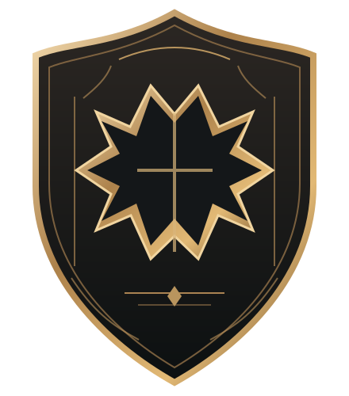

  

    An unofficial Warhammer 40,000 chronicle
    <h1>WILLIAMS WARHAMMER LORE</h1>
    

    
Armies are more than lists of units. Here, their <strong>oaths, warriors, relics, warships and battles</strong> become a living record—written alongside the actual collection and the games that follow.

    <a class="archive-cta" href="sons-of-sigismund/">Enter the first archive</a>
    <a class="archive-cta ghost" href="armies/">Browse armies</a>
  

  

01 / The active volume

## Sons of Sigismund

A small, fleet-based **Black Templars** household, newly commissioned by High Marshal Helbrecht. Led by a sword-bearing Marshal who fights beside his brothers, the order protects the Imperium's history while carrying its relics into war.

  
<strong>10</strong>Founding Sword Brethren

  
<strong>02</strong>Initial attached squads

  
<strong>00</strong>Recorded post-founding battles

  <a class="archive-card" href="sons-of-sigismund/history/founding/">I · HistoryA standard raised on ArmageddonThe Sword Brother's last campaign before Helbrecht entrusted him with a household of his own.↗</a>
  <a class="archive-card" href="sons-of-sigismund/characters/founding-marshal/">II · PersonaeThe Founding MarshalA fearless swordsman, traditionalist, brother and exceptional battlefield orator.↗</a>
  <a class="archive-card" href="sons-of-sigismund/fleet/righteous-crusader/">III · FlagshipThe Righteous CrusaderA strike cruiser, fortress-monastery and armored reliquary still being mapped.↗</a>
  <a class="archive-card" href="sons-of-sigismund/traditions/">IV · TraditionsThe Trial of SwordsMentorship, earned yellow heraldry, sacred vows and the Litany of the Blade.↗</a>
  <a class="archive-card" href="sons-of-sigismund/relics/">V · ReliquarySword and StandardThe two founding relics and the household's duty to protect the memory of the faithful.↗</a>
  <a class="archive-card" href="sons-of-sigismund/campaigns/">VI · ChronicleThe wars yet to be writtenA campaign record that grows only as real tabletop engagements take place.↗</a>

02 / The wider collection

## More armies. More histories.

The archive is designed to grow beyond the Sons of Sigismund. Future volumes can document the **Esoteric Cabal**, **Heralds of Decay**, **173rd Armored Rangers**, **Chaos Knights**, **Task Force DEADFALL**, and **Blood Angels** without mixing their histories.

<a class="archive-cta ghost" href="armies/">Explore the army index</a>

<strong>A living record, not an invented one.</strong> Approved lore is identified as established, design work remains provisional, and campaign results enter the record only after games are played or events are expressly approved.

Unofficial fan-made archive. Not affiliated with or endorsed by Games Workshop. Warhammer and related names belong to their respective owners.

