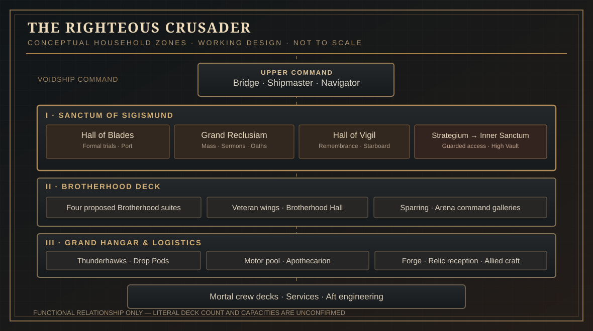

# 7.9 Deck Register, Capacity Notes and Planning Diagram

The Righteous Crusader · Summary reference for future floor plans

Historic working archive retained Geometry, scale and room sizes not final

This is the **compact architectural register** for *The Righteous Crusader*. The original 19-page working ship archive has now been expanded into **separate room-by-room wiki pages** for each major deck region. Use those articles for the detailed walkway and room connections; this page prevents duplicating the full prose while preserving the counts, the conceptual drawing and important continuity rules.

The **three principal Space Marine levels** are the **Sanctum**, **Brotherhood Deck** and **Grand Hangar/Logistics**. Above or forward lies an upper bridge complex; crew services and engineering continue on multiple deeper levels. The labels here are functional **regions**, not certified literal deck numbers.

*Existing conceptual zone sketch. It does not depict all six major regions, final room geometry or a surveyed Imperial strike cruiser.*

## I. Sanctum of Sigismund {#i-sanctum-of-sigismund}

The Sanctum contains the **Grand Reclusiam**, the **port Hall of Blades**, the **starboard Hall of Vigil**, the **Grand Strategium behind the Reclusiam's paired doors**, and the guarded **Inner Sanctum** with Marshal's rooms, the six household guards, proposed Castellan suite, Archives, Chaplaincy, private Council Chamber and High Relic Vault. VIP wings and the command-lift connection are kept distinct.

[Full Sanctum of Sigismund room walkthrough →](sanctum.md)

## II. Brotherhood Deck {#ii-brotherhood-deck}

Four originally proposed accommodation complexes contain an entrance barracks, central shared floor, Neophyte bunk section, Initiate alcoves, equipment/hygiene passage, dedicated armory, sparring room and supervising Sword Brother chamber. Shared training galleries connect mirrored pairs. Two veteran wings and the single open Great Brotherhood Hall occupy the same broad residential level. Upper Thunderhawks, pod launch galleries, allied wings and Valkyrie-capable positions operate at this elevation.

[Full Brotherhood Deck room walkthrough →](brotherhood.md)

## III. Grand Hangar and Logistics {#iii-grand-hangar-and-logistics}

The lower central deployment platform holds **two planned Thunderhawk positions**. Broad vehicle routes continue to the **motor pool, stores and protected magazines**. Two independent large arenas have their **fighting floors** here and observation at Brotherhood elevation. Separate **Astartes Apothecarion**, **Mortal Medicae**, **Techmarine forge** and adjacent **relic intake/quarantine/examination** complete the medical and industrial zone.

[Full Hangar and Logistics room walkthrough →](hangar-logistics.md)

## IV. Bridge and upper ship command

High and forward lie the ship's human-operated **bridge**, Shipmaster's normal bridge approach, separate Navigator domain and the **dedicated command lift from the Sanctum Strategium**.

[Full Upper Command and Bridge walkthrough →](upper-command.md)

## V. Mortal crew and services

The permanent mortal personnel live and work across **several** decks with their own quarters, messes, shrines, maintenance passages and service lifts; they are not confined to the allied barracks and do not share the Marshal's chambers.

[Full Mortal Crew and Services walkthrough →](mortal-crew.md)

## VI. Engineering and drives

Deep/sternward engineering houses ship propulsion, major power, life support and related technical services. It is separate from the Astartes forge on the Logistics Deck.

[Full Engineering and Drives walkthrough →](engineering.md)

## Original working capacities

| Space | Planning figure | Essential qualification |
|---|---|---|
| Grand Reclusiam | ~160 standing Astartes | Not founding troop strength |
| Great Brotherhood Hall | ~160 seated | One room with open arches, not several smaller halls |
| Four Brotherhood suites | 20 Neophyte berths + 10 Initiate alcoves **each** | Original **30-berth suite design**; *later* military goal is 20 Marines **per** Crusading Squad |
| Veteran wings | 15 rooms on each side, **30 total** | Marshal's six personal bodyguards sleep elsewhere |
| Main arena pair | 2 independent, double-height halls | Lower fighting floors / upper training C&C |
| Thunderhawk positions | 4: two lower, one upper port, one upper starboard | Position plan, not confirmed aircraft complement |
| Drop Pods | 12: 3 ready + 3 reserve **per side** | **Six launch-ready**, not twelve in firing tubes |
| Valkyrie-capable positions | 6: three per side | Allied servicing capacity, not owned aircraft |
| Allied quarters | ~200 each wing; ~500 surge model | Does not describe permanent mortal crew |
| Apothecarion | 30–40 wounded Astartes surge planning | Not simultaneous surgical stations |
| Ship's bridge | ~25–40 mortal/servitor watch figure | Informal working estimate, not approved complement |

## Mandatory continuity distinctions

The **Grand Reclusiam** is a worship hall. The **Grand Strategium** is the operational war room **behind its paired doors**. The **bridge** is ship command. The **Marshal's Council Chamber** is private. The **Hall of Blades** is a ceremonial dueling hall, and the **two large arenas** and everyday **Brotherhood sparring rooms** are different facilities. The **training C&C rooms** command exercises only. **Relics are processed below** before entering the upper sanctum. **Crew, allied visitors and Marines have deliberately separate access routes**.

The ship's literal deck count, hull geometry, launch tube orientation, hangar clearances, exact inventory, accommodations in use and personnel roster all remain **open**. The source record should be read as a **working architectural continuity archive**, not a finalized engineering specification.

[Start at the uppermost bridge →](upper-command.md) · [Return to flagship overview →](righteous-crusader.md) · [Operational routes →](operational-routes.md)
