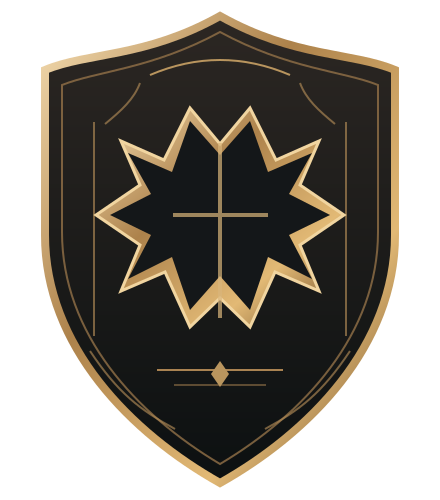

  

    Williams Warhammer Lore · Order dossier 001
    <h1>SONS OF SIGISMUND</h1>
    

    
<strong>Memory in the shield. Faith in the blade.</strong> A close-knit Black Templars crusading household, formed by Helbrecht's commission and led from the front by a warrior who believes Imperial memory can strengthen the living.

    <a class="archive-cta" href="history/founding/">Read the founding history</a>
    <a class="archive-cta ghost" href="#contents">Browse this dossier</a>
  

  

Encyclopedia record · Founding and organization

The **Sons of Sigismund** are a homebrew **Black Templars crusading household** of the Imperium of Man. Their existence is a recent appointment *within* the Black Templars, **not the creation of a separate successor Chapter**. They serve the Eternal Crusade while recovering, preserving and defending Imperial relics, sacred records and sites of remembrance. Their flagship, ***The Righteous Crusader***, is both an operational strike cruiser and a travelling fortress-monastery.

| Record | Detail |
|---|---|
| **Name** | Sons of Sigismund |
| **Affiliation** | Imperium of Man · Black Templars |
| **Primarch lineage** | Rogal Dorn, through the Black Templars |
| **Founding classification** | New crusading household; no numbered Chapter Founding |
| **Commissioned by** | High Marshal Helbrecht |
| **Founding Marshal** | Veteran Sword Brother; name undecided |
| **Homeworld** | None; fleet-based |
| **Fortress-monastery** | *The Righteous Crusader* (strike cruiser) |
| **Founding theater** | Armageddon |
| **Specialization** | Relic recovery, custody, historical memory and morale; prosecution of the Eternal Crusade |
| **Initial permanent cadre** | Marshal, original Chaplain, Emperor's Champion and ten Sword Brethren |
| **Initially attached forces** | Two Crusader Squads; squad sizes and personnel not finalized |
| **Chapter emblem and dress** | Black Templars cross; weathered black armor, white pauldrons, earned optional yellow for Sword Brethren |
| **Motto / battle cry** | Not yet formally established |

  
<strong>10</strong>Founding Sword Brethren

  
<strong>06</strong>Of them: honor guards

  
<strong>00</strong>Recorded post-founding battles

<strong>Continuity note:</strong> The Marshal's famous Armageddon victory happened <em>before</em> the Sons of Sigismund were founded. Their first battle as a new household remains unplayed. This is original fan-created lore, with unresolved details left clearly open.

## Table of contents

<nav class="codex-toc" id="contents" aria-label="Article contents">
  <ol>
    <li><a href="#chapter-origins">Chapter Origins</a>
      <ol>
        <li><a href="#the-sword-brother-before-armageddon">The Sword Brother — Before Armageddon</a></li>
        <li><a href="#the-defining-armageddon-campaign">The Defining Armageddon Campaign</a></li>
        <li><a href="#the-summons-and-the-writ-of-crusade">The Summons and the Writ of Crusade</a></li>
      </ol>
    </li>
    <li><a href="#chapter-organization">Chapter Organization</a>
      <ol>
        <li><a href="#overall-organization-and-ranks">Overall organization and ranks</a></li>
        <li><a href="#the-marshals-household">The Marshal's Household</a></li>
        <li><a href="#crusading-squads">Crusading Squads</a></li>
        <li><a href="#organization-recruitment">Recruitment and advancement</a></li>
        <li><a href="#organization-heraldry">Heraldry and honors</a></li>
        <li><a href="#organization-armor-schemes">Armor and paint schemes</a></li>
        <li><a href="#organization-shared-support">Shared support and specialists</a></li>
      </ol>
    </li>
    <li><a href="#combat-doctrine">Combat doctrine</a></li>
    <li><a href="#beliefs-and-traditions">Beliefs and traditions</a>
      <ol>
        <li><a href="#the-trial-of-swords">The Trial of Swords</a></li>
        <li><a href="#the-litany-of-the-blade">The Litany of the Blade</a></li>
        <li><a href="#oaths-and-custodianship">Oaths and custodianship</a></li>
      </ol>
    </li>
    <li><a href="#notable-individuals">Notable individuals</a></li>
    <li><a href="#relics-and-reliquary">Relics and reliquary</a></li>
    <li><a href="#fleet-and-fortress-monastery">Fleet and fortress-monastery</a></li>
    <li><a href="#allies-and-imperial-relations">Allies and Imperial relations</a></li>
    <li><a href="#campaigns-and-battles">Campaigns and battles</a></li>
    <li><a href="#gallery-and-miniatures">Gallery and miniatures</a></li>
    <li><a href="#sources-and-editorial-status">Sources and editorial status</a></li>
  </ol>
</nav>

## 1. Chapter Origins {#chapter-origins}

The origins of the household have **three stages**: the Sword Brother's life before Armageddon, the defining campaign, and the summons that led to Helbrecht's commission. The history ends with the original muster, **before the new order's first deployment**.

### 1.1 The Sword Brother — Before Armageddon {#the-sword-brother-before-armageddon}

Already an experienced veteran of the Black Templars, the future Marshal is a frontline swordsman, mentor and severe traditionalist. His childhood, recruitment world, earlier masters and rise through the Sword Brethren are still being written.

### 1.2 The Defining Armageddon Campaign {#the-defining-armageddon-campaign}

On Armageddon, the Sword Brother recovered an ancient standard and relic sword, rallied Imperial defenders over a prolonged campaign, and deliberately brought an original regional Ork Warboss into a highly visible duel. His victory helped launch a sustained **Imperial regional counteroffensive**. These battles occurred **before his commission**.

### 1.3 The Summons and the Writ of Crusade {#the-summons-and-the-writ-of-crusade}

Helbrecht **summoned** him, recognized his leadership, and offered him a Marshal's commission. The new household received a mandate to prosecute the Eternal Crusade while recovering and safeguarding Imperial relics and memory. The existing strike cruiser ***The Righteous Crusader*** was assigned and refitted as a mobile fortress-monastery and reliquary.

The original muster brought together the **Marshal, founding Chaplain, Emperor's Champion, ten permanent Sword Brethren and two attached Crusader Squads**. The **full historical roster and allocation of the ten** now live in the [Chapter Origins record](history/founding.md#the-cruiser-and-first-muster), rather than being copied into every organizational page.

[Read Chapter Origins in full →](history/founding.md)

## 2. Chapter Organization {#chapter-organization}

The Sons of Sigismund are a **small Black Templars household** led by the **Marshal** with a **Castellan as second-in-command**. The **Sword Brethren** remain Household veterans, even when assigned to the order's frontline Crusading Squads.

The **long-term goal is four Crusading Squads of 20 Space Marines each**, with **one Sword Brother and 19 Initiates/Neophytes in each squad**. This is a future force structure, not a claim that all 80 Marines are currently mustered. Only **two attached Crusader Squads** are recorded at the founding, with squads III and IV reserved for future growth.

### 2.1 Overall organization and ranks {#overall-organization-and-ranks}

A simple command chart runs **Marshal → Castellan → Marshal's Household → Sword Brethren → four Crusading Squads**. The Chaplain and Emperor's Champion retain distinct sacred duties; the Sword Brethren's squad assignments do not sever their Household affiliation. High Marshal Helbrecht remains parent-Chapter authority, rather than a command tier inside the household's chart.

[Overall chart and rank structure →](organization/chain-of-command.md)

### 2.2 The Marshal's Household {#the-marshals-household}

The command core includes the Marshal, the Castellan position, the founding Chaplain and Emperor's Champion, **six personal Sword Brethren guards**, and other Household veterans. Individual assignments and names remain in the Household register, rather than being duplicated in the founding narrative.

[Marshal's Household roster →](organization/marshals-household.md)

### 2.3 Crusading Squads {#crusading-squads}

 <a class="archive-card" href="organization/crusading-squads/first/">2.3.1 · FoundedFirst Crusading SquadOne original attached Crusader Squad with two founding Sword Brethren serving alongside.↗</a>
 <a class="archive-card" href="organization/crusading-squads/second/">2.3.2 · FoundedSecond Crusading SquadOne original attached Crusader Squad; senior veteran assignment still open.↗</a>
 <a class="archive-card" href="organization/crusading-squads/third/">2.3.3 · PlannedThird Crusading SquadFuture 20-Marine formation, with an assigned Household Sword Brother.↗</a>
 <a class="archive-card" href="organization/crusading-squads/fourth/">2.3.4 · PlannedFourth Crusading SquadFuture 20-Marine formation, with an assigned Household Sword Brother.↗</a>

These are **small squad-scale formations**, not companies with their own permanent staff and supporting detachments. The 20-Marine goal **includes** the Sword Brother assigned to each squad. The historical **ten founding Sword Brethren**—six honor guards, two with the First founding squad, one duelist and one reserve—are not doubled or silently reassigned.

[Crusading Squad rosters and future formations →](organization/crusading-squads/index.md)

### 2.4 Recruitment and advancement {#organization-recruitment}

Black Templars recruitment, temporary service under the Marshal, the **Oath of Allegiance**, and promotion through the **Trial of Swords** are separate processes.

[Recruitment and advancement →](organization/membership.md)

### 2.5 Heraldry and honors {#organization-heraldry}

The household retains weathered black armor, white pauldrons and Black Templars heraldry. **Yellow is an earned, optional Sword Brother distinction**, not an automatic scheme for every officer.

[Heraldry and markings →](organization/heraldry.md)

### 2.6 Armor and paint schemes {#organization-armor-schemes}

The grimdark miniature palette uses neutral gray definition and battle wear, **not blue edge highlights**. Specific painting recipes remain working references, separate from in-universe rank markings.

[Armor and painting →](organization/armor-schemes.md)

### 2.7 Shared support and specialists {#organization-shared-support}

The household shares its medical, forge, relic-custodianship, transport and voidship services across the four eventual Crusading Squads. **No squad automatically has a Castellan, permanent medical staff, forge team or dedicated vehicle complement.** The organizational register tracks responsibilities and open appointments without inventing extra founding personnel.

[Shared support and specialist duties →](organization/shared-support.md)

<strong>Historical founding roster?</strong> It remains in <a href="history/founding/">Chapter Origins</a>. These pages show the ongoing organization, assignments and working squad rosters as the army develops.

## 3. Combat doctrine {#combat-doctrine}

The Marshal is a **frontline swordsman** who expects to fight alongside his brothers, carrying the founding relic sword rather than remaining detached from the battle. The order favors a **concentrated operational footprint**: small detachments may guard sites or support related engagements, but the core brotherhood remains together and the Marshal repeatedly fights with familiar warriors.

The household has a distinctive mission: **recover, authenticate, secure and preserve Imperial relics and records while pursuing the Eternal Crusade**. Such recovered history can also strengthen the morale and convictions of Imperial defenders. The order does not abandon necessary combat for antiquarian pursuits.

The working naval doctrine avoids needlessly risking its ship and irreplaceable cargo in prolonged voidship engagements when a more suitable approach is available. The exact ground-combat tactics and formations are still to be developed.

[Mandate and doctrine](doctrine/index.md)

## 4. Beliefs and traditions {#beliefs-and-traditions}

The Sons of Sigismund inherit the Black Templars' reverence for the **God-Emperor**, sacred vows, intolerance of His enemies and the martial example of Sigismund. Their own growing identity emphasizes the memory of sacrifice, the sacred weight of recovered objects and **inspiration through example**. The deeds of ordinary Imperial defenders are worthy of remembrance, not only the accomplishments of Space Marines.

### 4.1 The Trial of Swords {#the-trial-of-swords}

A mentor Sword Brother trains an Initiate in arms, history and faith. The candidate undergoes formal duels against his sponsor and other Sword Brethren in the **Hall of Blades**. Successful induction confers Sword Brother standing and its optional yellow-heraldry privilege.

### 4.2 The Litany of the Blade {#the-litany-of-the-blade}

The household has an **approved ceremonial litany**, beginning:

> A sword without purpose is but sharpened iron.  
> A warrior without faith is but flesh awaiting death.

The complete text is preserved on the [Traditions and Litany](traditions/index.md) page. **The litany's final line is recited only at induction**, not during ordinary use.

### 4.3 Oaths and custodianship {#oaths-and-custodianship}

The **Oath of Allegiance** makes a brother permanently sworn. A **separate, still-unfinalized relic-custodianship vow** would accompany the duty of safeguarding an entrusted artifact. The household's detailed practices of penitence, daily devotion and serf relations remain unfinished.

[Traditions and Litany](traditions/index.md) · [Custodianship](relics/custodianship.md)

## 5. Notable individuals {#notable-individuals}

The household's biographical record remains deliberately modest until its original officers and brothers are named. This is where **personal stories and relationships** belong—not a second list of military posts.

**The Founding Marshal** is the central established character: a reserved, austere, highly capable swordsman who fights beside the same brothers and can deliver an extraordinary exhortation when a defense seems lost. His early life and response to failure remain open.

The **Emperor's Champion**, **founding Chaplain** and the veterans who serve beside the Marshal have established places in the force, but their individual names and histories have not yet been approved. The Castellan's place as deputy is established in the organizational hierarchy, but his identity and commissioning history remain open.

[Founding Marshal's biography →](characters/founding-marshal.md) · [Character dossier index →](characters/command-household.md) · [Sword Brethren dossier index →](characters/sword-brethren.md)

## 6. Relics and reliquary {#relics-and-reliquary}

The **founding sword** and **ancient battle standard** were recovered during the Marshal's pre-commission Armageddon campaign. The sword was wielded in the duel against the Warboss; the standard became a rallying symbol. Neither has a final name or documented provenance.

As the household develops, its reliquary will record **artifact histories, custodians, examination and conservation status, and confirmed campaign appearances**. Its archives and High Relic Vault are planned aboard *The Righteous Crusader*.

[Explore the relic register →](relics/index.md) · [Custodianship duties →](relics/custodianship.md)

## 7. Fleet and fortress-monastery {#fleet-and-fortress-monastery}

The Sons' flagship, ***The Righteous Crusader***, is an existing Black Templars **strike cruiser** assigned and adapted for their work. It serves as warship, mobile fortress-monastery, repository of Imperial memory and home for the close-knit brotherhood.

All **ship layout, decks, crew routes, hangars, reliquary spaces and capacity planning** belong in the dedicated fleet dossier—not in the founding or organizational entries.

[The Righteous Crusader →](fleet/righteous-crusader.md) · [Deck-by-deck guide →](fleet/deck-guide.md)

## 8. Allies and Imperial relations {#allies-and-imperial-relations}

The household remains answerable within the Black Templars and may serve alongside other crusades. The founding Marshal's cooperation with Imperial Guard officers on Armageddon informs the order's respect for faithful mortal defenders.

The ship is planned to accommodate allied Astra Militarum contingents. A narrative tie to the **173rd Armored Rangers** is a **working possibility**, not a recorded joint battle. Specific ties to the Mechanicus, Ecclesiarchy, Inquisition, Deathwatch and other institutions are still to be developed; no member's Deathwatch service has been established.

## 9. Campaigns and battles {#campaigns-and-battles}

The Marshal's victory over the regional Ork Warboss is **pre-commission history** and is documented in [Chapter Origins](history/founding.md). It is not a victory attributed to the household after its creation.

**Recorded post-founding tabletop battles: 0.** New campaign entries will document played engagements, their participants and consequences rather than assume results.

[Campaign chronicle →](campaigns/index.md) · [Battle-report template →](campaigns/battle-log-template.md)

## 10. Gallery and miniatures {#gallery-and-miniatures}

The miniature collection is the **physical source for future images and character identities**. The planned progression includes the Marshal, Emperor's Champion, Crusader Squad veterans, honor guards, Redemptor Dreadnought, Impulsor and Techmarine. Their arrival on the tabletop will be recorded independently of their place in the *founding* roster.

**Photo gallery not yet populated.** Only approved photographs and appropriately licensed or original illustrations will be published.

## 11. Sources and editorial status {#sources-and-editorial-status}

This is **original fan-created lore**, not official Games Workshop fiction. The encyclopedia structure was informed by the provided **Black Templars wiki contents outline** and **Chapter Creation Tables headings**. Our approved founding decisions take precedence over older internal drafts. Generic homebrew Chapter prompts are adapted to a **crusading household** rather than applied literally.

- [Research library and external sources](../research/index.md)
- [Continuity register: established, working, open and superseded](archive/canon-status.md)
- [Project source and editorial notes](archive/sources.md)
- [Detailed development roadmap](../research/next-topics.md)

<strong>Founding coverage:</strong> the reason, principal circumstances, Helbrecht's role, homeworld status, lineage, relics, leadership character, founding force and first deployment are established. Exact founding date, names, particular gene-seed record and any defining internal flaw remain open. These are intentionally <em>not</em> invented to fill a form.

Unofficial fan-made Warhammer 40,000 lore encyclopedia. Not affiliated with or endorsed by Games Workshop. Warhammer and Black Templars are associated with Games Workshop.

